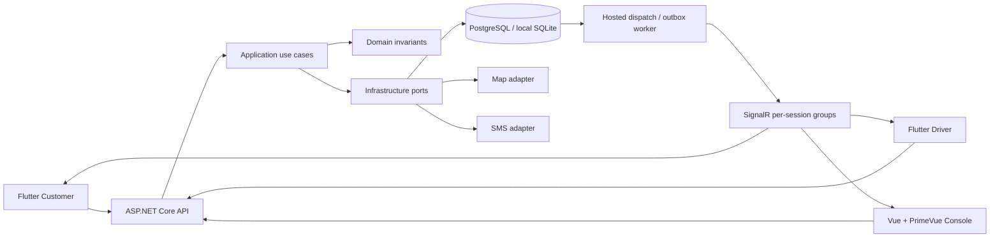

# Kiến trúc triển khai

## Giao dịch

`AtomicExecutor` serialize command local bằng `SemaphoreSlim`. Với PostgreSQL, lấy `pg_advisory_xact_lock(721601)` trong transaction Read Committed để các instance dùng cùng thứ tự. Các unique partial index vẫn là hàng rào cuối. Đây là lựa chọn cho bản phát triển quy mô nhỏ: khóa toàn bộ command là nút thắt cần chuyển sang khóa theo aggregate với thứ tự nhất quán trước khi tăng tải.

Command ghi business state, RideEvent, Outbox và IdempotencyRecord trong transaction. Sai PIN/OTP dùng lỗi có cờ persist để attempts được commit mà không chuyển trạng thái nghiệp vụ. Lỗi khác rollback. Idempotency được kiểm tra trước expectedVersion.

`Quote` gọi provider bên ngoài transaction rồi lưu; `Ride` consume Quote trong transaction riêng. Worker dispatch đóng offer cũ trước khi tái sử dụng slot unique. Tài xế được reserve bởi open offer và bị bận bởi active Assignment.

Outbox phát ít nhất một lần. Client chỉ dùng thông báo làm tín hiệu tải snapshot; không suy ra thanh toán hoặc start thành công từ push/socket. Backoff và giới hạn attempt đưa message chưa phát qua ngưỡng vào dead-letter để vận hành kiểm tra.

## Giá và tài chính

`FarePolicy.Calculate` tính VND bằng `long` và tỷ lệ `decimal`. Quote chứa FareBreakdown và policy version; Ride giữ lại snapshot. P0 không có phụ phí/promo tự động.

Khi complete: debit phải thu khách; credit phải trả tài xế và phí nền tảng. Khi thu tiền mặt: debit phải trả tài xế; credit phải thu khách. Vì tài xế giữ tiền mặt, phần đã giữ bù vào nghĩa vụ, không trở thành khoản có thể rút thêm. Quyền lợi chưa thu được đưa vào pending; số dư âm biểu thị công nợ. Nộp công nợ được xác nhận bởi người khác và tạo journal mới.

Mô hình tài khoản là mô hình kỹ thuật phục vụ phát triển, chưa phải hệ thống kế toán pháp định đã được phê duyệt.

## Bảo mật

- Access token 15 phút, refresh 30 ngày; hash refresh server-side, rotation và reuse revocation.
- Resource ownership và scope vùng ở server. Customer/driver ID lấy từ session.
- Session bị khóa bị từ chối ở JWT validation. Hub không cho client tự join group; message chỉ gửi session còn hợp lệ.
- PIN dùng HMAC và Data Protection cho bản cần trả riêng cho khách; không xuất qua DTO tài xế.
- File local nằm ngoài web root; GET yêu cầu bearer và owner/reviewer scope. Chỉ JPEG/PNG có signature hợp lệ, tối đa 5 MB, file đã complete mới được gắn vào hồ sơ. Production cần storage/scanning adapter.
- Không thu raw thẻ, không có gateway giả, không cho sửa balance/status trực tiếp.
- Web local dùng bearer trong sessionStorage; production cần hoàn thiện OIDC/MFA và mô hình quản lý phiên phù hợp threat model.

## Mobile

Mỗi app là project Flutter độc lập. Domain pure Dart nằm trong `lib/core/domain`; repository interface không phụ thuộc Flutter/Dio. `lib/core/application` chứa use case; `core/data` map DTO và gọi HTTP qua `core/network/api_client.dart`. Dio được tạo theo provider riêng tại `core/network/api_providers.dart`, cấu hình URL/timeout/JSON tại `dio_config.dart`, dependency khai báo trực tiếp trong pubspec của từng app. `core/providers/app_providers.dart` nối repository, use case và session vào Riverpod. Theme/widgets nằm trong core của app; các màn hình nghiệp vụ ở features. Không sử dụng package Dart nội bộ qua path và không import source app còn lại.

Hai app có controller/state riêng. Widget render state và gọi controller; controller không giữ BuildContext. Trên resume và sự kiện socket, app đọc REST snapshot. Lệnh complete/cash bị lỗi mạng được lưu secure storage theo tài khoản, giới hạn 32 lệnh/24 giờ. Khi mở lại, UI cho phép replay bằng body/key gốc; PIN không được lưu trong queue. Logout xóa queue để không gửi dưới tài khoản khác. Request đang chạy có session epoch để response/refresh cũ không ghi đè phiên mới. Phiên đổi làm provider rebuild, dispose subscription/timer và tạo state mới.

## Lịch sử và quyền riêng tư bổ sung

Lịch sử dùng keyset CreatedAt/ID và HMAC cursor theo actor + filter; composite index CustomerId/CreatedAt/ID phục vụ danh sách. Native JourneyRepository tách khỏi RideRepository để các command đang chạy không phụ thuộc trạng thái màn hình danh sách. Phân trang giữ generation guard và dedupe ID khi cập nhật.

SavedPlace và TrustedContact có ownership, optimistic version và soft deletion đồng thời xóa trường PII chính. TrustedContact.PhoneProtected dùng Data Protection. AtomicExecutor bảo vệ response idempotency mới vì chúng cũng có thể chứa PIN và PII; đọc tương thích record JSON local cũ, nên vẫn cần kế hoạch retention/chuyển đổi dữ liệu cũ khi triển khai. Keyring cần backup và quyền truy cập phù hợp cùng DB.

Cache liên hệ nằm trong FlutterSecureStorage, gắn user ID và TTL 30 ngày, xóa khi logout/đăng nhập phiên mới. Session epoch ngăn response cũ ghi cache account mới; revision riêng ngăn GET chậm đưa lại số vừa xóa. Fallback chỉ dùng khi lỗi mạng hoặc HTTP 5xx; lỗi quyền/phiên không chuyển sang cache. Dialer chỉ mở sau thao tác của người dùng.

AccountDeletionRequest là workflow tiếp nhận/xem xét, liên kết support ticket. Chặn tiếp nhận khi có nghĩa vụ còn lại và cho phép rút yêu cầu. Xóa/anonymize cuối cùng và retention là phần chưa triển khai; không đánh dấu dataDeleted thành true.

## Khôi phục từng phần và giới hạn tải polling

Controller ưu tiên kết quả active Ride; các phần độc lập được tải song song và lỗi bổ sung trả thành cảnh báo thay vì làm toàn bộ state lỗi. Khoảng tải history/earnings là 30 giây khi Ride không đổi; snapshot đổi version và manual refresh được kiểm tra ngay; command đổi Ride bỏ cache để vòng đồng bộ kế tiếp tải lại. Timestamp/generation/revision chỉ được cập nhật khi response còn hiệu lực. Cache active trong history không được ghi đè active=null; detail 404 xóa bản active cũ.

Ghi session dùng queue tuần tự có epoch, cùng cơ chế fence khi restore đọc secure storage. JSON local được kiểm tra shape trước khi cast; journal lỗi không kéo theo mất phiên hợp lệ. Response refresh phải là session hợp lệ của cùng user. Nếu request được gửi lại sau refresh vẫn trả 401, client thu hồi phiên local và phát sessionEnded một lần.

Sau cash thành công, driver đọc detail của đúng Ride để lấy payment, tải history/earnings độc lập. Nếu detail lỗi thì chặn thu thêm đến khi có snapshot mới; nếu còn cash operation trong recovery journal thì cần giải quyết operation gốc trước khi tạo khoản thu mới. Lỗi tải báo cáo không được diễn giải thành cash chưa commit.
